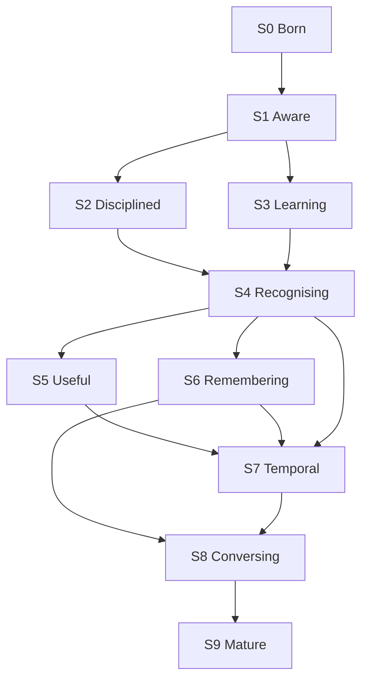

# SEMBLON — Earned history (maturity blueprint V1.9)

**Status:** Earned generations S0–S9 + how to absorb + how to measure.  
**North star and planned work:** `docs/SEM-ARCH.md` (one source of truth).  
**Not:** a schema, a ticket list, a v1 rewrite, or a second architecture.  
**Date:** 2026-09-19  
**Working name:** Semblon (`SEM-blon`)

**Core docs only**

| File | Job |
|---|---|
| `docs/PRODUCT.md` | frozen v1 (what the user can do now) |
| `docs/CONTRACTS.md` | schema / CLI / runtime |
| `docs/SEM-ARCH.md` | **north star + planned work** |
| **This file** | earned history + absorb + measure |
| `docs/runtime.md` | FACE-000 machine record |
| `docs/licenses.md` | licence record |
| `docs/FACE-GATES.md` | FACE-002→005 validation index |

`docs/ARCHITECTURE.md` and `docs/ROADMAP-RECONCILE.md` point at `docs/SEM-ARCH.md`. Discovery and observatory files remain pointers to §18 / §19 here. Do not maintain a second plan anywhere. There is no `SEMBLON_IMPLEMENTATION_PLAN.md` and no OBS / SIM / VISION clock.

FACE-002 → FACE-005 **validation is recorded** (`docs/FACE-GATES.md`). **S1 PASS — closed.** Do not retune `eps`. Do not re-run FACE-005 scale work. Do not invent a 10k claim. Do not implement MediaPipe, CLIP, objects, live, public lookup, ACC, or a vector database because this file is extensive.

---

## 0. How to read this

Four files, four jobs. Do not collapse them:

```
PRODUCT v1 ........ what the user can do now (frozen)
CONTRACTS ......... schema / CLI / runtime
SEM-ARCH .......... north star + planned work
THIS FILE ......... earned S0–S9 + absorb + measure
```

FACE-004 is not “Semblon is mature.” S9 is not a v1 backlog. This file does not redefine PRODUCT v1. Planned work is not a FACE-n queue.

Operating model (frozen 2026-09-12; do not reopen):

```
BUILD → SCAVENGE → MEASURE → KEEP/ADAPT/DEFER/REJECT → GOLDEN (if justified) → PROMOTE → NEXT STAGE
```

`review.html` is evidence, not an automatic kill. Observatory answers “did this stage get better?”, not “may we experiment today?” Do not remap stage names. Do not start a GUI because S8 exists on paper. Do not invent OBS / SIM / VISION ticket numbers.

**Architecture may anticipate the future. Implementation must earn it.**

---

## 1. North Star

**Authority:** `docs/SEM-ARCH.md`. Do not restate or fork that board here.

Semblon is a **local visual intelligence system**. Faces are the first mature capability, not the centre. Planned work is `CORE → PROVIDERS → OBSERVATIONS → CONNECTIONS → MEMORY`.

Identity work already earned (this file’s generations):

```
observe faces → organise → measure → review as evidence → recognise
  → remember time/place → see sequences → interrogate → extend
```

System structure as earned / still true (destination detail lives in SEM-ARCH):

```text
SEMBLON
│
├── Source adapters — folder (now) · video / live (later) · future
├── One decode / normalization path
├── Observation engine
│     ├── FaceKit — identity                          ← current
│     ├── geometry (landmarks, hands, pose)           ← future
│     ├── appearance / quality (colour, sharpness, …) ← future
│     ├── object / region                             ← future
│     └── semantic image representation               ← future
├── Separate spaces: identity · geometry · appearance · semantic
├── Space-specific comparison — never one global distance
├── Explicit relationship queries — never silent identity fusion
├── Human review → human meaning (person / gallery)
├── Identification
├── Later: video / live
├── Later: public-information enrichment
└── Last: ACC as a client
```

Implementation still earns the next box:

```text
folder → FaceKit → conservative clustering → review → persons → identification
       → hardening → only then broader observation
```

**Developmental rule:** every generation must leave Semblon *more capable*, not more complicated and not more impressive-looking. Maturity is accumulated capability, not accumulated features.

### 1.1 Current product remains narrow

v1 is this slice only (`docs/PRODUCT.md`):

```text
folder stills → decode → FaceKit detect → filter → FaceKit embed
  → compare() (same pack_id) → conservative cluster → review.html
  → human review → named persons → gallery → 1:N identify → unknown
```

v1 does **not** require hands, pose, objects, scene understanding, CLIP, public web search, video, live camera, ACC, a vector database, cloud, semantic clustering, or composite identity scoring.

### 1.2 Capability map

Status is what exists today. **Planned work is `docs/SEM-ARCH.md`.** Do not turn this table into tickets.

| Capability | Space | Role | Status |
|---|---|---|---|
| Face detection | identity | locate candidate faces | **Current** |
| Face embedding | identity | identity representation | **Current** |
| Face comparison | identity | identity similarity | **Current** |
| Face clustering | identity | conservative grouping | **Current** |
| Human review | human meaning | resolve clusters | **Shipped** |
| Person gallery | identity / human meaning | named identities | **Shipped** |
| 1:N identification | identity | identify against gallery | **Shipped** |
| Face landmarks | geometry | facial structure | Future |
| Hands | geometry | hand / keypoint observations | Future |
| Pose | geometry | body / keypoint observations | Future |
| Colour | appearance | image / region attribute | Future |
| Sharpness / brightness | appearance / quality | evidence quality | Future |
| Objects | object / semantic | object observations | Future |
| Regions / segmentation | semantic / geometry | region observations | Future |
| Semantic image representation | semantic | visual semantic similarity | Future |
| Per-space similarity | space-specific | similarity queries | Future |
| Relationship queries | cross-space, explicit only | discover relationships | Future |
| Video | source | temporal observations | Later (S7a–b) |
| Live | source | real-time observations | Later (S7c–d) |
| Public information | enrichment | external context | Much later (S9) |
| ACC | integration | external client | Last (S9) |

Broader work is sequenced in `docs/SEM-ARCH.md`, not as `FACE-n → OBJECT-n` and not as an OBS / SIM clock.

### 1.3 Candidate technology — names are not authorization

| Capability | Candidate | Role |
|---|---|---|
| Identity | InsightFace / FaceKit | identity only |
| Face / hand / pose geometry | MediaPipe Tasks | future geometry observer |
| Image measurements | OpenCV / conventional CV | appearance / quality |
| Semantic representation | CLIP or successor | semantic space |
| Objects / regions | specialist models | future observers |
| Vector retrieval | FAISS / Qdrant / Milvus / … if justified | infrastructure only |

A name here does not authorize install. Selection must still pass accuracy, Windows x64 / ARM64 native (emulated labelled), code **and** model licence, footprint, CPU / memory, offline use, maintainability, and CONTRACTS. Attractive and unlicensed is rejected.

| Thing | Is | Is not |
|---|---|---|
| FaceKit / InsightFace `buffalo_l` | identity engine (internal eval) | replaceable by CLIP / MediaPipe / dlib |
| MediaPipe Tasks | future geometry enrichment of an *accepted* FaceKit face | second identity detector |
| CLIP or successor | future semantic representation | landmark detector; identity; person clusterer |
| Vector DB | optional future retrieval | observation or intelligence |
| dlib / `face_recognition` | donor comparison | selected identity architecture |
| FastAPI / SearXNG / network fallbacks | later / isolated / off by default | current core |
| Whole-image semantic vector | semantic space if ever authorized | identity embedding |

If MediaPipe is eventually used: keep provenance to the FaceKit observation; do not replace the identity embedding; do not silently change clustering; a MediaPipe face that FaceKit rejected is not an identity observation.

### 1.4 Separate spaces

```text
                 OBSERVATIONS
                      │
       ┌──────────────┼──────────────┐
       ↓              ↓              ↓
   identity        geometry       appearance  (+ semantic)
       │              │              │
       ↓              ↓              ↓
 identity sim     geometry sim    appearance sim
       └──────────────┴──────────────┘
                      │
                 explicit query → relationships
```

Each space has its own representation, provenance, comparison, thresholds, and failure modes. Today's `observations` row is a source/frame slot, not a typed `{kind, space, payload}` schema. Do not add those columns to satisfy this diagram.

A future `related --spaces geometry,appearance` is **not** `identity = weighted(identity + geometry + appearance)`.

### 1.5 Identity firewall

Only FaceKit embeddings under a `pack_id` may affect identity clustering, thresholds, DBSCAN, person assignment, gallery assignment, or 1:N identification.

Must **not** silently influence identity: landmarks, hands, pose, colour, sharpness, brightness, objects, scene similarity, CLIP / semantic vectors, composite feature vectors.

1. No composite similarity as a new identity threshold.
2. Do not glue identity false splits with other spaces.
3. Other spaces may be shown in review or queried explicitly. They must not vote on identity or raise ACCEPT.
4. False split > unjustified false merge. Wrong identity > unknown. Do not relax thresholds to beautify clusters.

Withdrawn: “appearance agrees → identity confidence may rise.”

---

## 2. What the outside world actually shows

Mature systems do not sell “an embedding engine.” They sell:

```
photos → people → organisation → search → memory
```

| System | What it demonstrates | What Semblon takes | What Semblon refuses |
|---|---|---|---|
| **Immich** | Faces grouped and shown as *people*; name; merge; feature photo; search; video faces; tunable detection score and recognition distance | Incremental library, named people, merge, feature/exemplar photo, conservative distance | Presenting a cluster as a person; server/multi-user/mobile; CLIP as identity |
| **PhotoPrism** | Detect → embed → DBSCAN cluster → *manual assign* to person; cluster optimisation as new faces arrive; embeddings L2-normalised; **do not mix embedding models** (SFace 128 vs FaceNet 512) | Separated detect/embed/cluster; pack identity; quality gates; cluster ≠ auto-person in the engineering sense | Auto-optimise clusters into identity; background “make it a person” |
| **Facet** | Face grouping *plus* quality, blink, duplicates, timeline, metadata, semantic search | Quality as first-class; merge suggestions; duplicate/burst as observation quality | Culling product; gallery-as-the-app in v1 |
| **FaceSorter** | Folder → cached scan → clusters → review → saved people → later scans only process new files | The S1→S5 operational loop | Copy-out `person/` as the identity store; cluster = person |
| **CompreFace** | Verification (1:1) ≠ identification (1:N vs a collection) | Keep both verbs explicit | A recognition *service* API as the product |
| **NIST FRTE** | Accuracy is FMR/FNMR at operating points, plus demographic differentials — not one “99%” | S2: evidence, confirmatory sets, FAR/FRR | Shipping NIST-scale claims from a family album |
| **UK ICO** | Biometric data used for unique identification is special-category; accuracy is statistical not factual; by-design / minimisation / security | Privacy as a product layer from S0 | Cloud identity; hidden network; “the system said so” |

Sources: §17.

The developmental ladder those systems imply, cleaned for Semblon:

```
see → group → measure → review-as-evidence → recognise → run unattended
    → remember time/place → see sequences → interrogate → extend
```

---

## 3. Governing invariants (do not invert)

These bind every generation. A later stage may *add* a capability. It may not repeal these.

1. **`cluster → review → person → name`.** Never `cluster = person`.
2. **Unknown is valid.** Refusal to identify is a feature. Wrong identity > unknown. False merge > false split.
3. **Evidence before confidence.** Similarity is not identity. Top-1 / top-2 / margin / quality / gallery size / condition belong in the decision, not a single score.
4. **Human corrections are evidence, not silent truth and not model training.** Record the decision. Do not pretend a merge retrained buffalo_l.
5. **Local-first. No hidden network.** External lookup, if it ever exists, is explicit, auditable, off by default.
6. **`pack_id` is the compare key.** Family name (`insightface/buffalo_l`) is a label. Weights + adapter + version are identity. Mismatched packs do not compare.
7. **Files stay put.** SQLite + originals are authoritative. Export folders are views.
8. **One user, personal, Windows CLI for v1.** Multi-user / sharing / mobile / ACC-in-process are out of v1 and are S9 *clients*, not a rewrite of the engine.
9. **Still images are the birth environment. Temporal vision is a second modality**, not a plugin bolted onto a stills-only brain. Today's contracts must not make video impossible. (`observations.frame_id`, `media.source_type` in `{folder,video,live}` already exist — keep them.) Folder-first validation is not skipped because video exists on paper.
10. **Tracking is not a recogniser.** Detection, tracking, embedding, comparison, clustering, identification are distinct.
11. **`compare()` is a primitive**, not a product subsystem. FaceKit / InsightFace remains the identity engine.
12. **buffalo_l is internal evaluation only** until a licensed pack decision. Fallback path (YuNet + SFace) is recorded, not a current ticket.
13. **Identity firewall.** See §1.5. Geometry, appearance, object, and semantic representations must not silently influence identity.

---

## 4. Two source families, one observation engine

Do not design:

```
image product  →  later add video
```

Design:

```
                 SEMBLON
                    │
             ┌──────┴──────┐
             │             │
        STILL SOURCES   TEMPORAL SOURCES
          folders         video files
          libraries       webcam
                          RTSP
             │             │
             └──────┬──────┘
                    ↓
            OBSERVATION ENGINE
                    │
     FaceKit identity (current)
     geometry / appearance / semantic (future; separate spaces)
                    │
          detect / quality / tracking*
                    ↓
         represent (per space — not one global vector)
                    ↓
         compare inside that space
              ↙         ↘
   identity cluster    identify (identity only)
              ↘         ↙
                review
                   ↓
                persons
                   ↓
             visual memory
                   ↓
            query / evidence
                   ↓
          CLI · UI · ACC client
```

\* Tracking is active only for temporal sources.

Current implementation is the **identity slice** of this engine (FaceKit detect → filter → embed → `compare()` → conservative cluster). Future observers must not collapse into that identity `compare()`.

A photograph is **one source frame**. Today's `observations` row is that frame slot, not a typed multi-kind record.  
Video is **a stream of observations belonging to evolving entities**.

That is why S7 is a generation, not a codec ticket. Broader observers are not S7 either — they are architectural candidates mapped later, never an OBS-* clock.

---

## 5. The closed loop (target at maturity)

```
OBSERVE
  → ASSESS QUALITY
  → REPRESENT
  → COMPARE
  → CLUSTER / IDENTIFY
  → ASSESS EVIDENCE
  → DECIDE
  → UNKNOWN WHEN NECESSARY
  → HUMAN REVIEW
  → RECORD DECISION
  → IMPROVE GALLERY / EVALUATION
  → OBSERVE AGAIN
```

v1 only needs the still-image slice of this loop through **reviewed persons + identify**. The loop is the destination, not the 0.4 sprint.

---

## 6. Generations

Each generation: **new capability**, **user gain**, **exit**, **disposition of work**, **what this stage must not do**.

### S0 — Born · see faces

**Capability.** There is a face here; it can be represented numerically, with provenance.

**User gain.** Almost none. Acceptable.

**Must establish**

- Model load, ORT CPU, workers=1
- Arch detection; `native` vs `emulated` (never label x64-on-ARM64 as native)
- `pack_id` = family + versions + weight hashes
- Timing / RSS
- One-image detect + embed
- Local-only
- Reproducible run record (`runtime_json`)

**Exit.** Semblon can reliably observe faces on the supported Windows executions.

**Disposition**

| Item | Verb |
|---|---|
| FACE-000 lab profile | KEEP (current) |
| buffalo_l internal eval | KEEP |
| Licensed pack / YuNet+SFace fallback | DEFER (licence record already exists) |
| GPU providers | DEFER until evidence |

**Must not.** Ingest, cluster, GUI, FAISS, five adapters.

**Engineering.** FACE-000. Partially present (`semblon lab profile`). `docs/runtime.md` still to be filled on x64 native and ARM64 native-or-fail+emulated.

---

### S1 — Aware · organise observations

**Capability.** These faces *appear* to belong together. Not: this is John.

**User gain.** An unstructured folder becomes reviewable groups.

**Pipeline**

```
folder → hash → detect → filter → embed → compare → conservative cluster → static review.html
```

**Semblon gains**

- Command ingest (no watcher)
- sha256 identity; files stay put
- `rejected` / `low_quality` / `ok`
- Conservative clustering of `ok` only, same `pack_id`
- Unknown / unassigned bucket
- Static HTML: REVIEW REQUIRED → STRONG → UNASSIGNED → REJECTED
- Worst-pair evidence + `min_intra`
- Reproducible export (read-only)

**The review page is the first sensory feedback loop**, not a pretty artifact. Mixed vs strong vs junk is the acceptance test.

**Exit.** A real dump produces a page on which mixed, strong, and junk are distinguishable. Use that page to decide whether DBSCAN (and its knobs) survive.

**Disposition**

| Item | Verb |
|---|---|
| 0.2 ingest | KEEP (on `main`) |
| 0.3 cluster + `review.html` | KEEP (on `main`; **S1 PASS — closed** on `20260913T153515Z-1e915abe`) |
| Interactive dashboard | REJECT for this stage (DEFER to S8) |
| FAISS / HDBSCAN-as-architecture | REJECT until evidence |
| cluster = person | REJECT |

**Must not.** Name people. Identify. Watch folders. Serve HTTP.

**Engineering.** FACE-001 / builds 0.2–0.3. Code on `main`. **Acceptance = dump-gate. S1 PASS — closed.**

---

### S2 — Disciplined · measure trustworthiness

**Capability.** “How good?” replaces “the clusters look pretty good.”

**User gain.** None directly. The product becomes honest.

**Semblon gains**

- Genuine / impostor / hard-negative pairs
- Frozen confirmatory sets (immutable)
- Mined discovery tail (not confirmatory)
- FAR / FRR / FNMR at operating points
- Top-1 / top-2 / margin
- Cluster impurity
- Underpowered-evaluation state (refuse to print precision)
- Pack-specific evaluation
- Optional stratification (quality, condition; demographic only where the set supports it)

NIST FRTE exists because accuracy is **not one number**: FMR and FNMR move with dataset, time gap, yaw, quality, and demographic group.

**Decision shape this stage makes possible later**

```
top1, top2, margin, gallery size, quality, condition, confirmatory operating point
  → ACCEPT | UNKNOWN
```

**Exit.** Semblon can say what it knows, what it does not, and whether a claim is underpowered.

**Disposition**

| Item | Verb |
|---|---|
| FACE-002 eval harness | KEEP harness on path (`semblon lab eval`; precision only on frozen confirmatory). Dump set recorded: `docs/FACE-002-CONFIRMATORY.md`. |
| Printing precision without `--eval-set confirmatory` | REJECT |
| Remine refreshing confirmatory | REJECT (already in CONTRACTS) |
| Public accuracy marketing | REJECT |

**Must not.** Change identity rules because a number looked nice.

**Engineering.** FACE-002 harness on the `lab eval` path. Local dump `s1-confirmatory` is harness-measurable (11/11/1; FAR 0/11, FRR 1/11 at 0.60). That is a 22-pair family dump, not 10k, not FRTE. See `docs/FACE-002-CONFIRMATORY.md`.

---

### S3 — Learning · human judgement as structured evidence

**Capability.** Review does more than fix today's cluster. It produces operational evidence.

**User gain.** Merge / split / reject / assign with a history that can be audited.

**Loop**

```
cluster → human review → merge / split / reject / assign
        → record decision (who, when, faces, run, pack)
        → later: did this reveal a clustering weakness?
```

**Semblon gains**

- CLI `merge` / `split` / `name` (v1 surface)
- Correction history (`decisions`)
- Ambiguous-cluster priority (already hinted by worst `min_intra`)
- Bridge-pair detection (candidate)
- Recurring hard-negative tracking (candidate)
- Best/worst exemplars (candidate)
- Review provenance

**Exit.** Human corrections are stored as decisions. The recogniser is not silently “retrained.” Cluster is still not a person until named.

**Disposition**

| Item | Verb |
|---|---|
| 0.4 name / merge / split | KEEP (code on `main`); dump review evidence in `docs/FACE-003-REVIEW.md` |
| `decisions` rows | KEEP (schema already) |
| Merge *suggestions* | DEFER unless the dump shows they are needed to finish 0.4 |
| Neural fine-tuning on the user's album | REJECT |
| Undo | ADD in 0.4 if cheap; else S5 |

**Must not.** Auto-promote a cluster to a person because it is STRONG.

**Engineering.** FACE-003 + build 0.4 (code on `main`). v1 product requires this. Queue position after dump-gate is unchanged.

---

### S4 — Recognising · reviewed people, new observations

**Capability.** A new still can be compared to a **gallery of reviewed persons**. Unknown remains legal.

**User gain.** The first transformative product: “is this someone I already named?”

```
reviewed person → trusted exemplars → gallery
new face → quality → embed → compare gallery → top1/top2/margin → ACCEPT | UNKNOWN
```

This is where `cluster ≠ person` becomes: **cluster → reviewed identity**.

**Semblon gains**

- Person records (`active` / `retired`)
- Trusted exemplars + quality
- Identification (1:N) distinct from verification (1:1)
- Evidence explanation (at least in data, even if CLI-printed)
- Person merge / split / reassignment / retirement
- Identity history
- Optional export folders as *views*

**Exit.** Semblon recognises a known person without forcing every face to have a name. v1 ship test is satisfied.

**Disposition**

| Item | Verb |
|---|---|
| 1.0 identify vs persons | ADD after 0.4 |
| Verification vs identification as explicit verbs | KEEP |
| ANN / FAISS | DEFER (SQLite + exact compare until evidence) |
| Automatic identity | REJECT |
| Webcam | DEFER (v2 / S7c) |

**Must not.** Identify against clusters. Identify with mixed packs.

**Engineering.** FACE-004 / build 1.0. **v1 product completes here.**

---

### S5 — Useful · incremental, unattended stills

**Capability.** The user stops babysitting. New files are processed; unknowns have an inbox.

**User gain.** Leave it running (or re-run cheaply) rather than re-ingest the world.

**Semblon gains**

- Incremental ingest (hash skip already exists; generalise across runs)
- Unknown-person inbox: KNOWN / UNKNOWN / REVIEW REQUIRED / REJECTED
- Unknowns can later become people
- Better exemplars (size, sharpness, pose, blur, illumination)
- Duplicate / near-duplicate / burst as **observation quality**, not a product
- Resume, cache, progress, resource-aware scheduling
- Watcher is allowed *here*, not in v1

**Exit.** Re-running on a growing folder is incremental and conservative.

**Disposition**

| Item | Verb |
|---|---|
| Hash skip same-run | KEEP (0.2) |
| Cross-run incremental + inbox | ADD (post-v1 / FACE-005) |
| Folder watch | DEFER to S5 (REJECT in v1) |
| Duplicate product | MERGE into observation quality |
| Background daemon | EXPERIMENT at S5 |

**Must not.** Start a watcher in 0.4 to look busy.

**Engineering.** FACE-005 and later. **After v1 ship and a real-use reassessment.**

---

### S6 — Remembering · visual memory

**Capability.** Not only “who,” but when / where / with whom.

**User gain.** Person history, co-appearance, crude events.

**Semblon gains**

- Person × time
- Person × place (EXIF/GPS when present; no geocoding service required)
- People together
- Events from timestamps, folders, bursts, people, proximity — not an LLM
- Person history across years
- Cross-condition gallery (frontal / profile / glasses / indoor / outdoor / cameras)

**Exit.** Semblon answers “where and when have I seen this person?” from data it owns.

**Disposition**

| Item | Verb |
|---|---|
| Timeline / co-appearance | ADD at S6 |
| LLM event titles | DEFER / EXPERIMENT; first pass is structured signals |
| Maps product | DEFER |
| Semantic CLIP search | DEFER (candidate **semantic** representation — not identity, not landmarks) |

**Must not.** Build a Google Photos clone before identification is trustworthy.

---

### S7 — Temporal vision · sequences, not frames-as-photos

**Capability.** Visual observations as sequences. A bad frame does not destroy a good track.

Rename from the earlier label “Experiencing”: the capability is **temporal vision**.

**Architectural purpose (do not reduce to “add video UI”).**

> Prove that Semblon’s observation and identity model extends through time.

Photo and video share one intelligence model. Video adds **time**. The GUI (S8) may *render* temporal evidence; it does not invent a second identity engine.

**Conceptual model (reuse existing contracts; no new columns until earned)**

```text
IMAGE
  └── Face observation          (faces row; observations.frame_id IS NULL)

VIDEO
  ├── Frame                     (observations.frame_id, t_ms)
  │    └── Face observation
  └── Appearance (temporal)     (track / presence interval over observations)
       └── face observations across time

Face observation
       ↓
compare() vs confirmed person references (same pack_id)
       ↓
Identity hypothesis
       ↓
strong evidence  → Known / CONFIRMED (after human or ACCEPT policy)
ambiguous/weak   → UNKNOWN (preferred over wrong ID)
near-threshold / multi-candidate → POSSIBLE (UI/intelligence state; map carefully — today identify is ACCEPT|UNKNOWN only)
```

**Naming collision — do not collapse:**

| Term | Meaning in Semblon |
|---|---|
| **Appearance (temporal)** | S7 track / presence interval (“seen 14:32–14:37”) |
| **appearance space** (§1.5) | colour / sharpness / quality — must **not** vote on identity |

**Person / references (already true for stills; S7 must keep it)**

```text
Person
 ├── confirmed reference A   (human-named face / exemplars)
 ├── confirmed reference B
 └── future observations
```

A known person available as a reference does **not** force assignment of every ambiguous video face. Wrong identity > unknown. No automatic enrolment from STRONG or from “vaguely close” similarity.

**Sub-stages (do not flatten)**

| Sub | Source | Constraint |
|---|---|---|
| **S7a** | Video files | Can seek, go slow, revisit, build a complete timeline |
| **S7b** | Tracking / tracklets (= temporal Appearances) | Identity persistence, occlusion, representative frames |
| **S7c** | USB webcam (product v2) | Latency, budget, dropped frames, never force ID |
| **S7d** | RTSP / continuous | Same as live, plus always-on policy and retention |

**Pipeline (all sub-stages)**

```
temporal source
  → frame sampling
  → detection
  → tracking (Appearances)
  → quality selection
  → selective embedding
  → identification vs persons (not vs clusters)
  → temporal evidence
  → presence intervals / events
```

**Schema already kept for S7 (do not invent parallel tables yet)**

- `media.source_type` ∈ `folder` | `video` | `live`
- `observations.frame_id`, `t_ms` nullable; stills unique where `frame_id IS NULL`

Tracklets / Appearances may later be derived evidence or a thin table — only when S7a/b implementation requires it. Do not add columns for a paper model.

**Semblon gains**

- Tracklets / temporal Appearances
- Selective embed (not 30 recognisers per second)
- Confidence accumulation across frames
- Appearance / disappearance (“Seen 14:32–14:37”)
- Unknown remains valid on live (log; optional prompt to name)
- Same Intelligence Canvas overlays as stills (face boxes + Inspector)

**Relationship to S8 GUI**

S7 extends the **domain**. S8 renders observations/people/Appearances on an Intelligence Canvas (photo and video). Opening a GUI shell does **not** open S7 engine work. **S7a is open** (Phase 1 human tests approved 2026-09-17; `docs/S7A.md`). S7b–d still wait.

**Exit.** People understood across time, not as independent JPEGs. A video session produces tracks and presence intervals, not a JPEG storm.

**Disposition**

| Item | Verb |
|---|---|
| `observations.frame_id`, `source_type=video\|live` | KEEP (already in DDL) |
| Video files in PRODUCT v1 stills ship | REJECT as v1 *requirement*; **S7a is the post-v1 ticket** (`docs/S7A.md`) |
| USB webcam | DEFER to v2 = S7c |
| RTSP | DEFER to S7d |
| Separate tracking-recogniser module | REMOVE (absorb into temporal observation) |
| Force-ID on camera | REJECT |
| Auto-assign known person on vague similarity | REJECT |

**Must not.** Run still-image ingest on every frame. Must not let GUI dictate a new backend identity architecture.

---

### S8 — Conversing · interrogate visual memory

**Capability.** A human can explore memory and see *why* Semblon accepted or refused.

**User gain.** Search and evidence, finally worth a richer UI.

**Shipped vertical (smallest S8):** Interactive Review (`semblon review-ui`) — Name / Merge / Split / Ignore / Note over existing `review.py`. See `docs/S8-REVIEW-UI.md`.

**Target product surface (design; implement in slices):** one persistent **application shell** + contextual workspaces + shared **Intelligence Canvas** — not a pile of disconnected pages, not a ChatGPT UI, not a cluster/embedding admin tool.

```text
                    SEMBLON
                       │
            ┌──────────┴──────────┐
            │  APPLICATION SHELL  │
            └──────────┬──────────┘
                       │
     ┌─────────────────┼─────────────────┐
     │                 │                 │
  SIDEBAR          WORKSPACE          GLOBAL
     │                 │            Search / Settings
     │                 ▼
 LIBRARY / PEOPLE   INTELLIGENCE CANVAS
 Home Photos Videos    ├── Photo (+ face boxes)
 People Unknown        ├── Video (+ boxes, timeline, Appearances)
 Activity              └── Person (references, media)
                       │
                       ▼
                   INSPECTOR
```

**Primary navigation (user mental model — not internal nouns)**

```text
LIBRARY: Home | Photos | Videos
PEOPLE:  People | Unknown
WORK:    Activity
──────── Settings
```

Do **not** put embeddings, observations, clusters, runs, models, providers, exports, reports in the primary nav unless a real user need appears.

**Intelligence Canvas**

| Mode | Shows |
|---|---|
| Photo | Source still + face-region overlays + selection |
| Video | Playback + face overlays + timeline + Appearances / people present |
| Person | Confirmed references + photos + videos + Appearances + evidence |

Face boxes are the visual language for **observations** (never bake into source media). Conceptual overlay states: UNKNOWN / POSSIBLE / CONFIRMED — map to existing identify/review outcomes; do not invent a second identity engine. Today `identify` returns ACCEPT|UNKNOWN only; POSSIBLE is a **planned UI state** (e.g. near-threshold / multi-candidate) requiring an explicit contract before implementation.

**Inspector** (contextual, not a separate app): select face/person/Appearance → inspect scores / confirm / name / keep unknown — calling `review.py` / `identify.py`, not GUI-local logic.

**Processing:** consume `process_folder(..., on_event=...)` for truthful progress; structured `process.completed` (run_id, store, out) before “Open Review” without scraping stdout. Cancellation and workers/EP remain separate deferred tickets.

**Semblon gains (full S8)**

- Interactive review: merge / split / assign / unassign / undo / neighbouring observations *(partially shipped in review-ui)*
- Search the memory it owns: `Alex`, `Alex + Sarah`, `Alex in 2023`, `unknown in July`
- Evidence surface (accept / unknown with reasons)
- CLI remains. Static HTML remains as an artifact. UI is a *view* on the same store.

**Exit.** A user can interrogate a conclusion without trusting a vibes-based thumbnail grid. Feel: “I’m looking at my media, and Semblon is showing me what it knows” — not “I’m operating AI utilities.”

**Disposition**

| Item | Verb |
|---|---|
| Interactive Review slice (`review-ui`) | KEEP / shipped vertical |
| Application shell + Intelligence Canvas | ADD in slices after Phase 1 validation |
| Cluster Review dashboard from earlier mockups | PROMOTE only as Canvas/Inspector — not a second product |
| CustomTkinter / FastAPI / Electron / web stack as v1 | REJECT |
| Natural-language chatbot over photos | REJECT as core |
| Google-Photos-class semantic stack | DEFER |
| Search as foundation of first GUI | REJECT — plan later |

**Must not.** Build the full shell “because Immich has one.” Must not open S7 engine work merely because Canvas designs mention video.

**Wireframes (information architecture — implement in slices; native shell, not web. Toolkit undecided pending `docs/S8-TOOLKIT.md`; tkinter `review-ui` remains the shipping vertical)**

```text
┌─ SEMBLON ──────────────────────────────── Search ─ ⚙ ─┐
│ LIBRARY          │  WORKSPACE / CANVAS                 │
│  Home            │                                     │
│  Photos     ●    │   [ media / person surface ]        │
│  Videos          │                                     │
│ PEOPLE           │   ───────────────────────────────── │
│  People          │   INSPECTOR (contextual)            │
│  Unknown         │   identity · actions · evidence     │
│ WORK             │                                     │
│  Activity        │                                     │
└──────────────────┴─────────────────────────────────────┘
```

| Workspace | Canvas / body | Inspector (on selection) |
|---|---|---|
| **Home** | Recent media + open Activity if process running; entry to choose folder | — |
| **Photos** | Grid of stills from store; open → Canvas(Photo) | Face / person actions via `review`/`identify` |
| **Videos** | Grid of `source_type=video` (empty until S7a); open → Canvas(Video) | Appearance / face / person |
| **People** | Named persons + reference thumbs | Person dossier |
| **Unknown** | Unassigned / UNKNOWN faces (stills first) | Possible matches + Confirm / Name / Keep unknown |
| **Activity** | Live `on_event` progress → completion → Open Review / Photos | — |
| **Settings** | General / Processing / Recognition / Library / Appearance / Diagnostics / Advanced | policies, not ONNX internals |

**Canvas(Photo)** — source image + face boxes (UNKNOWN / POSSIBLE / CONFIRMED styling) + selection → Inspector.  
**Canvas(Video)** — same overlays + playback + timeline + Appearance lanes (“who / when”); seek on Appearance click. Requires S7a+ evidence.  
**Canvas(Person)** — confirmed references + linked photos/videos/Appearances.  
**Transitions:** Sidebar changes workspace in-place; selecting media/person opens Canvas without leaving the shell; Settings and Search are overlays/workspaces, not separate apps.

**Slice order (after Phase 1–2)**

1. Shell chrome + Photos + People + Canvas(Photo) + Inspector (wrap `review_ui` / domain APIs)  
2. Activity consuming `on_event` (+ structured completion when shipped)  
3. Unknown + identify UI (needs POSSIBLE contract)  
4. Videos / Canvas(Video) only after S7a evidence exists  
5. Global search last among these

---

### S9 — Mature · local visual-intelligence platform

**Capability.** Still, video, live, memory, evidence, and *isolated* extensions share one observation/identity architecture.

**User gain.** Semblon is reusable. Other software consumes it. It does not become those other products.

**Extensions (isolated, explicit, off by default)**

- Public lookup
- External libraries / Immich as a *source or client*
- NAS
- ACC as a **client of standalone Semblon** (never ACC-in-process)
- Licensed pack if anyone else gets a copy

**Exit.** New sources and new query surfaces do not require a new identity model.

**Disposition**

| Item | Verb |
|---|---|
| ACC plugin inside FaceKit/Semblon process | REJECT |
| Cloud identity service | REJECT |
| Multi-user / sharing / mobile app | DEFER; likely never core |
| Licensed pack | DEFER until that situation exists |

---

## 7. Ladder (compact)

| Stage | Name | Major new capability | Product transformation | Build now? |
|---|---|---|---|---|
| S0 | Born | See faces | Engine exists | FACE-000: ARM64 OpenCV binary proven; x64 native unverified |
| S1 | Aware | Group observations | Organises dumps | **S1 PASS — closed.** 90 stills. |
| S2 | Disciplined | Measure accuracy | Knows its limits | FACE-002 recorded (22 pairs; FAR 0/11 FRR 1/11). |
| S3 | Learning | Human evidence | Gets better through review | FACE-003 recorded. STRONG ≠ person. |
| S4 | Recognising | Reviewed people | Identifies known people | FACE-004 recorded. Identify vs persons. **v1 ship** |
| S5 | Useful | Incremental + regression | Effortless stills + frozen-param guard | 1.1 inbox on `main`. FACE-005 regression recorded. 10k not run. |
| S6 | Remembering | Time / place / events | Visual memory | 1.2 `memory` on `main` |
| S7 | Temporal vision | Sequences | Video / track / live / RTSP | **S7a OPEN** 2026-09-17 (`docs/S7A.md`). S7b–d deferred. |
| S8 | Conversing | Review + Canvas | Human sees/corrects what Semblon knows | **review-ui shipped**; full shell later |
| S9 | Mature | Platform / clients | Extensible local VI | Future |

---

## 8. Dependencies



Hard rules:

- **S4 requires S1 + S3.** You cannot identify against people you did not review.
- **S4 should see S2** before claiming operating points. A 1.0 identify can ship with unknown-by-default if confirmatory eval is thin; it must not print fake FAR.
- **S7 requires S4.** Live identify vs *persons*, not vs clusters.
- **S8 requires S4 and prefers S6.** A dashboard on un-named clusters is the thing we already refused.
- **S5 does not require S6–S9.** Incremental stills are the first post-v1 candidate.
- **S2 does not block 0.4.** Measuring can proceed in parallel with name/merge/split once the dump is readable. It *does* block boastful metrics.

---

## 9. FACE map (earned engineering, not the queue)

Closed identity work. Not the planned-work source — that is `docs/SEM-ARCH.md`.

| Maturity | Engineering | Build version | Status 2026-09-12 |
|---|---|---|---|
| S0 | FACE-000 runtime | 0.1 | Code on `main`. Fill `runtime.md` on both Windows executions. |
| S1 | FACE-001 ingest + first reviewable result | 0.2 ingest, **0.3 cluster/export** | On `main`. **S1 PASS — closed** (`20260913T153515Z-1e915abe`). |
| S2 | FACE-002 confirmatory eval | `lab eval` | Harness on path. Local dump `s1-confirmatory` harness-measurable 2026-09-16 (`docs/FACE-002-CONFIRMATORY.md`). Store not in git. |
| S3 | FACE-003 decisions as evidence | **0.4** name/merge/split | Code on `main`. Dump merge+name evidence in `docs/FACE-003-REVIEW.md`. STRONG is not a person. |
| S4 | FACE-004 persons + identify | **1.0** | Code on `main`. Dump `--face`/`--image` evidence in `docs/FACE-004-IDENTIFY.md`. |
| S5 | FACE-005 regression / scale | **1.1** | Incremental/inbox already on `main`. Regression/scale: `docs/FACE-005-REGRESSION.md`. 10k not run. |
| S6 | visual memory | **1.2** | `memory history/together/events` on `main`. No new columns. |
| S7–S9 | future | v2 / later | Earned-history labels only. Planned work: `docs/SEM-ARCH.md` |

PRODUCT.md later-row mapping:

| PRODUCT | Maturity |
|---|---|
| v1 | S0–S4 stills slice |
| v2 USB webcam | S7c |
| later: video files | S7a–S7b |
| later: RTSP | S7d |
| later: click-to-lookup | S8 query |
| later: ACC as client | S9 |
| later: licensed pack | S9 |

---

## 10. Feature inventory (whole picture)

Verb set: **KEEP / ADD / MERGE / DEFER / EXPERIMENT / REPLACE / REMOVE / REJECT / PROMOTE**.

### Recognition foundation — KEEP as core

Detection · quality · embeddings · `compare()` · clustering · identification · unknown · evidence · evaluation · provenance · pack_id.

### Human intelligence — KEEP; surface grows

Review · merge · split · assign · undo · correction history · ambiguous queue · exemplar selection · trusted gallery.

v1 surface = CLI + static HTML. Interactive surface = S8.

### Operational — KEEP the idea; stage the mechanism

| Feature | Verb | Stage |
|---|---|---|
| Command ingest | KEEP | S1 |
| Incremental hash skip | KEEP | S1, generalise S5 |
| Watcher | DEFER | S5 (REJECT in v1) |
| Resume / cache / progress | ADD | S5 |
| Resource-aware scheduling | ADD | S5 / S7c |
| Dedup / burst | MERGE | into observation quality (S5) |

### Visual memory — DEFER after S4

People · timeline · locations · events · people-together · person history · visual search of *owned* memory.

### Temporal intelligence — DEFER; contracts KEEP

Video · tracking · tracklets · temporal evidence · selective embedding · live webcam · RTSP.

### Presentation

| Feature | Verb | Stage |
|---|---|---|
| CLI | KEEP | S0+ |
| Static HTML artifact | KEEP | S1+ |
| Rich local interactive UI | DEFER / PROMOTE | S8 |
| Desktop integration | DEFER | S8–S9 |
| FastAPI / CustomTkinter as v1 app | REJECT | — |
| Generic AI photo chatbot | REJECT | — |

### Observation spaces beyond identity — DEFER; map into S6+ / S7 / S8 when earned

Landmarks · hands · pose (geometry) · colour / sharpness / brightness (appearance) · objects / regions · semantic image representation (CLIP or successor) · per-space similarity · explicit relationship queries.

Not S1–S4 work. Not a new ticket taxonomy. Identity firewall (§1.5) applies.

### Extensions — isolated

Public lookup · Immich/NAS sources · ACC client · licensed pack: **DEFER to S9**. Cloud identity: **REJECT**. ACC in-process: **REJECT**.

### Concepts to REMOVE as separate architecture

| Concept | Absorb into |
|---|---|
| “Comparison module” | `compare()` primitive |
| “Tracking recogniser” | Temporal observation (S7) |
| “Duplicate product” | Observation quality / ingest |
| Massive vector infrastructure | Nothing until S4+ scale evidence |

### Permanently REJECT

- Automatic identity from clustering  
- Hidden network / cloud gallery  
- Forcing an ID on live video  
- Treating FACE numbers as maturity stages  
- Redesigning pack_id / reopening V4.x constitutions to chase S9  
- Mixing ACC / grok-fleet / other repos into this engine  

---

## 11. Privacy and governance (not a footnote)

UK ICO: biometric data **used for unique identification** is special-category biometric data. Recognition systems produce **statistically informed guesses, not facts**. Accuracy degrades with age and life events. Data protection by design, minimisation, security, and processes to correct or erase apply even to a personal local tool — especially if it ever leaves one machine.

Architectural consequences, staged:

| Control | From |
|---|---|
| Local-only default; no hidden network | S0 |
| Observation ≠ identity in the schema | S0 (already: `person_id` nullable) |
| Rejected faces: no embedding stored | S1 (already) |
| `pack_id` / run provenance | S0–S1 (already) |
| Decisions audit (who / when / what) | S3 |
| Unknown instead of a forced name | S4 |
| Export / delete person / retire person | S4 |
| Retention controls, source exclusions | S5–S7 |
| Optional encrypted store | EXPERIMENT S9 |
| Explicit audit of any external lookup | S9 |
| Re-enrolment / gallery refresh (ICO: references age) | S4–S6 (cross-condition exemplars) |

Records of ACCEPT/UNKNOWN should remain **evidence objects**, not “this is factually Alex.” That matches ICO accuracy guidance and Semblon's unknown-is-valid rule.

This document is not legal advice. It is a product constraint: privacy is a generation-zero property, not an S9 patch.

---

## 12. Cross-condition identity (gallery > model chasing)

Same person ≠ same appearance. Age, glasses, beard, hair, lighting, expression, camera, pose, distance, occlusion, quality.

This is primarily a **gallery / exemplar** problem, not “swap buffalo_l for the next pack.”

Target person record (S4–S6):

```
PERSON: Alex  status=active
Trusted exemplars
  frontal · profile · glasses · outdoor · indoor · older · other cameras
Rejected exemplars
  poor crop · ambiguous · suspected lookalike
```

A new pack is REPLACE only with a migration story (PhotoPrism's SFace-vs-FaceNet lesson: old embeddings are incomparable). Until then, **one pack_id per compare universe**.

---

## 13. Contracts that S0–S1 must not poison

Already in DDL — **KEEP**:

- `media.source_type` ∈ folder | video | live  
- `observations.frame_id` nullable; stills unique where `frame_id IS NULL`  
- `faces.person_id` nullable  
- `persons.status` active | retired  
- `decisions` with scores / margin  
- `eval_sets.frozen`  
- `compare()` pack_id + dim + length  

Do not:

- Assume one observation per file  
- Store embeddings without pack_id  
- Collapse cluster_id into person_id  
- Add FAISS as a required runtime  
- Add a network client “just in case”  
- Bind identity to a thumbnail filename  

---

## 14. Current position (honest)

```
S0  FACE-000     ARM64 OpenCV binary proven (PE 0xaa64), not consumed by Semblon.
                 x64 native FACE-000 unverified (no x64 PC).
S1  0.2 + 0.3    S1 PASS — closed (`20260913T153515Z-1e915abe`, 90 stills)
S2  FACE-002     recorded: 22 pairs, FAR 0/11, FRR 1/11 at frozen 0.60
S3  FACE-003     recorded: merge/name decisions; STRONG is not a person
S4  FACE-004     recorded: identify vs named persons (`--face` / `--image`)
S5  FACE-005     incremental/inbox 1.1 on main; regression/scale recorded;
                 live scale 90 stills; 10k not evidenced
S6               memory 1.2 on main (not part of FACE-002–005)
S7–S9            S7a + S8 Reviewability on main; later S7/S8 not started
Planned work     `docs/SEM-ARCH.md` (ARCH-001 next; docs only)
v1 ship          stills slice: ingest → cluster → review → name → identify
```

Completed validation sequence (evidence index: `docs/FACE-GATES.md`):

```
FACE-002 → FACE-003 → FACE-004 → FACE-005
```

Do not retune `eps`. Do not re-run FACE-005 scale. Do not start MediaPipe, CLIP, objects, or vector-DB work from this paper. Next work is named in `docs/SEM-ARCH.md`, not by opening the next FACE or S-number.

Deferred: bounded concurrent ingest workers; CPU/GPU execution-provider selection; recording actual provider/device/worker in run evidence.

---

## 15. Success criteria (maturity exits, not ticket AC)

| Stage | Exit in one sentence |
|---|---|
| S0 | Supported Windows executions can detect+embed with a real `pack_id` and honest `native`/`emulated`. |
| S1 | A real folder yields a static report in which mixed, strong, and junk are obvious. |
| S2 | Precision is only printed on frozen confirmatory sets; underpowered is a first-class state. |
| S3 | Merge/split/name leave decision evidence; STRONG clusters are still not people. |
| S4 | New stills identify against reviewed persons or return unknown; v1 ship test passes. |
| S5 | A growing folder is processed incrementally; unknowns have an inbox. |
| S6 | Person × time / together queries work on owned metadata. |
| S7 | A video or live session produces tracks and presence intervals, not a JPEG storm. |
| S8 | A human can see why ACCEPT or UNKNOWN was chosen. |
| S9 | An external client (e.g. ACC) consumes Semblon; Semblon does not live inside the client. |

---

## 16. How this record may change

North star and planned-work changes go in `docs/SEM-ARCH.md`. This file stays the earned-history + absorb + measure record. It is not a second frozen PRODUCT.md.

At every maturity transition, look outward and inward (§18), then apply exactly one verb per candidate:

```
KEEP · MERGE · PROMOTE · DEFER · REPLACE · REMOVE · REJECT
ADD and EXPERIMENT are allowed only with a stage and an exit criterion.
```

Rules:

1. PRODUCT.md v1 in/out is not amended by this file. If v1 scope must change, amend PRODUCT.md explicitly.  
2. CONTRACTS.md is not amended here. Schema changes are contract revisions.  
3. No generation may repeal §3 invariants.  
4. Do not open S(n+2) tickets because S(n) is boring.  
5. “A GitHub app has it” is not a promotion criterion. Dump evidence is.  
6. Version this file (V1, V1.1, …) with a dated changelog at the bottom.  
7. A scavenged KEEP is eligibility for a named stage, not a ticket.  
8. Do not remap S0–S9 in this file (they are earned history). Planned work is `docs/SEM-ARCH.md`. Clothing / CLIP / MediaPipe are not identity work.

---

## 17. Sources (research-backed, not decorative)

- PhotoPrism face pipeline (detect → embed → DBSCAN → assign): <https://docs.photoprism.app/user-guide/ai/face-recognition/> and developer notes on L2-normalised embeddings / model-specific distance.  
- Immich people: name, merge, feature photo, search, video faces, detection-score and recognition-distance: <https://docs.immich.app/features/facial-recognition>  
- Immich presents clusters as people — **negative example** for Semblon's identity boundary.  
- Facet (local scoring + faces + merge suggestions): <https://github.com/ncoevoet/facet>  
- FaceSorter (folder → cache → review → later incremental): <https://github.com/ChuckBuilds/FaceSorter>  
- CompreFace: identification vs verification as separate services: <https://github.com/exadel-inc/CompreFace>  
- NIST FRTE 1:1: FNMR at fixed FMR; demographic differentials: <https://pages.nist.gov/frvt/html/frvt11.html> · IR 8280 / IR 8429  
- UK ICO biometric recognition: special-category when used for unique identification; accuracy as statistical guess; security / PETs / by-design: <https://ico.org.uk/for-organisations/uk-gdpr-guidance-and-resources/lawful-basis/biometric-data-guidance-biometric-recognition/>  
- ICO accuracy: records should show statistically informed guesses not facts; re-enrolment as references age: <https://ico.org.uk/for-organisations/uk-gdpr-guidance-and-resources/lawful-basis/biometric-data-guidance-biometric-recognition/how-does-the-accuracy-principle-apply-to-biometric-data>  
- InsightFace buffalo family / ORT: engine, not the product. Weights: `docs/licenses.md`.  
- Google Photos “face groups” language: similar faces *likely* the same person — marketing softness Semblon should exceed by requiring review.

Donors are not ground truth. Study behaviour; do not import schemas, “cluster is a person,” or donor thresholds.

---

## 18. Absorb (process, not a clock)

Semblon grows by scavenging inside the **current** stage, not by copying Facet / Immich / CompreFace.

```
observe → investigate → test → learn → integrate → measure → mature
```

Classify each find: engine · workflow donor · algorithm · UX · performance · capability candidate · comparator · research lead · noise. “Interesting” ≠ “build.”

Value questions (at least one of 1–4 yes, and 5 yes): accuracy/trust · user time · cognitive effort · new capability · worth the complexity/resource/privacy cost. Speed that degrades identity is a regression.

Evidence card before anything hits the FACE queue:

```
Capability / source / date
What it does / problem / current Semblon equivalent
Accuracy · speed · RAM · privacy · Windows x64/ARM64 native vs emulated
Canonical stage (S0–S9 names) / class
Decision: KEEP | ADAPT | EXPERIMENT | DEFER | REJECT
```

KEEP = eligible for the named stage, not “build today.” EXPERIMENT = prototype, not production architecture.

Benchmark in three levels: (1) observe the donor, no conclusions; (2) reproduce the *behaviour* inside Semblon; (3) adversarial compare on Semblon’s values. Do not treat donor clusters as labels.

Performance firewall: report accuracy impact (or “not an identity claim”), latency, peak RSS. Objective is useful capability per resource, not max FPS. x64-on-ARM64 is never native.

Scavenge **inside** the current stage (S1: review/clustering behaviour; S2: eval; S3: review UX; S4: gallery/identify; S6+: extra spaces behind §1.5; S7: temporal; S8: search; S9: clients). S1 does not scavenge clothing transformers.

---

## 19. Measure (not a development gate)

The observatory prevents unexplained regression from being mistaken for progress. It does not block dump-gate or 0.4. CLI lives in `semblon lab observatory` (`snapshot` / `freeze` / `compare` / `enter`). Code is the behaviour; this section is the rule.

No composite “Semblon score.” Measure the identity path that exists. Do not invent CLIP / geometry / vector-DB scores.

| Family | Examples |
|---|---|
| Accuracy | genuine / impostor, FAR / FRR, hard negatives (FACE-002) |
| Recognition | top-1, top-2, margin, unknown |
| Clustering | impurity, worst intra-cluster pair |
| Detection | recall by size / quality |
| Speed / resources | first result, stage times, peak RSS |
| Effort | review decisions, corrections / 1k |

Three references, not interchangeable: **A** our golden baseline (commit / pack_id / config / corpus / hardware / native|emulated) · **B** external comparable (context, not pass/fail) · **C** our stage exit (§15). Promotion uses C, not B.

| Moment | Observatory |
|---|---|
| Everyday build | Optional |
| Pack / clusterer / runtime change | Compare to golden |
| Claim “stage is done” | Required (`--promote`) |
| Current dump / 0.4 CLI | **Not a gate** |

Verdicts: improvement · trade-off (accepted in writing) · regression (unexplained red → not mature) · not_measurable (do not fake it).

```text
semblon lab observatory freeze --store STORE --run R --stage S1 --notes "HUMAN REVIEW SENTENCE"
semblon lab observatory enter --stage S3 --store STORE --run R
```

`freeze` writes `observatory/golden-S1.json` beside the store. `--notes` stores the human dump-gate sentence on that golden. `enter` checks the completed-stage golden (S3 checks S1; S2 is parallel). Missing golden or regression: warn, exit 0. `--promote` is the only stick (exit 3). `name` / `merge` / `split` call enter S3 once — warn only.

**S1 PASS — closed.** Authoritative dump `20260913T153515Z-1e915abe` (Win ARM64 native, 90 `.jpg`): 85 faces, 78 ok, 10 clusters, 63 clustered, 15 eligible unassigned; no observed false merge; clusters are not people. Do not retune `eps=0.40`. Pin with `freeze --notes` on the Windows store when convenient.

FACE-002: `semblon lab eval`. Print precision only on a frozen confirmatory set that meets the powered floor (10 same, 10 different, ≥1 hard-negative near the identity boundary). Otherwise underpowered — counts only, no FAR/FRR. Remine writes `mined_discovery` only. Local dump set is recorded in `docs/FACE-002-CONFIRMATORY.md` (22 pairs; FAR 0/11, FRR 1/11 at 0.60). That is not a 10k claim.

---

## 20. Parked (not current FACE work)

faiss · hdbscan-as-default · milvus · qdrant · pyarrow · diskcache-as-truth · watchdog · fastapi · bytetrack · sqlalchemy · onnxruntime-gpu as only runtime · mediapipe · clip / open-clip · dlib / face_recognition.

A vector store is retrieval infrastructure, not intelligence. Do not add a parked library because §1.3 names it.

---

## 21. Changelog

| Ver | Date | Note |
|---|---|---|
| V1 | 2026-09-12 | First North Star. S7 renamed Temporal vision. FACE mapped. v1 build path unchanged. |
| V1.0.1 | 2026-09-12 | Pointer to Capability Discovery companion. No stage remap. |
| V1.0.2 | 2026-09-12 | Pointer to Engineering Observatory. Measurement only; not a gate. |
| V1.0.3 | 2026-09-12 | Wording: review page is evidence, not an automatic kill. Operating model frozen. |
| V1.1 | 2026-09-13 | Identity firewall. Spaces ≠ one embedding. 0.4 code exists; dump-gate queue unchanged. |
| V1.2 | 2026-09-13 | Hygiene: structure + absorb + measure live here. Companion files are pointers. No features dropped. |
| V1.3 | 2026-09-13 | S1 PASS — closed on `20260913T153515Z-1e915abe`. Next: FACE-002. |
| V1.4 | 2026-09-15 | FACE-002 eval harness on the `lab eval` path. Precision only on powered frozen confirmatory. Stage remains open; FACE-003 is not the next closable gate solely because harness code exists. |
| V1.5 | 2026-09-16 | FACE-002→005 validation recorded (`docs/FACE-GATES.md`). Incremental/inbox 1.1 and S6 memory 1.2 already on `main`. 10k not run. ARM64 OpenCV binary proven, not consumed. x64 native FACE-000 unverified. |
| V1.6 | 2026-09-16 | S7 temporal observation model + S8 shell/Intelligence Canvas IA reconciled (no engine code). Appearance (temporal) ≠ appearance space. POSSIBLE = planned UI state. Phase 1 remains review-ui validation (`docs/ROADMAP-RECONCILE.md`). |
| V1.7 | 2026-09-17 | Phase 1 human tests approved. S7a gate open (`docs/S7A.md`): sampled video-file observations on existing `frame_id`/`t_ms`. S7b–d and full S8 shell still deferred. eps frozen. |
| V1.8 | 2026-09-17 | S7a dump evidence `20260917T161452Z-a012c0fe`. S8 Reviewability: inspect video face observations via render-time seek/crop (`docs/S8-REVIEW-UI.md`). `observation ≠ tracklet ≠ person`; do not enable video DBSCAN to shrink unassigned. S7b after inspectability. |
| V1.9 | 2026-09-19 | North star and planned work move to `docs/SEM-ARCH.md` (one source of truth). This file remains earned history + absorb + measure. No FACE-n successor queue. No columns, no second detector. |

---

*Every generation must leave Semblon significantly more capable than the one before it. Not more complicated. Not more impressive-looking. More capable.*
