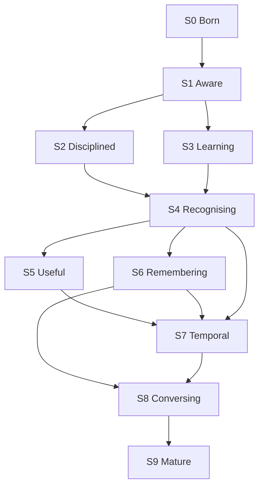

# SEMBLON MATURITY BLUEPRINT — V1

**Status:** North Star (capability). Not the implementation plan. Not the schema.  
**Date:** 2026-09-12  
**Working name:** Semblon (`SEM-blon`)  
**Scope:** S0 → S9. Still images, temporal vision, evidence, privacy, extensions.

This document answers *what Semblon is growing into*.  
`docs/PRODUCT.md` answers *what v1 ships*.  
`docs/CONTRACTS.md` answers *schema / CLI / runtime*.  
FACE tickets answer *what to code next*.

Do not implement S5–S9 because this document exists.

---

## 0. How to read this

| Document | Authority | Frozen? |
|---|---|---|
| `docs/PRODUCT.md` | v1 product (in / out / ship test) | Frozen 2026-09-12 |
| `docs/CONTRACTS.md` | Schema, CLI, pack_id, metrics | Authoritative until a contract revision |
| **This file** | Capability North Star | V1 freeze. Revisable only via §16 |
| FACE tickets / build versions 0.x | Staging / engineering | Current: **0.3 on `main`**. Next code: dump-gate, then 0.4 |

Three different clocks:

```
PRODUCT v1 ........ ship a local stills CLI with reviewed persons
BUILD 0.1–1.0 ..... tickets under S0–S4
MATURITY S0–S9 .... capability generations (this file)
```

They must not be collapsed. FACE-004 is not “Semblon is mature.” S9 is not a v1 backlog.

---

## 1. North Star

Semblon is a **local visual-intelligence system** that develops from observing faces, to organising them, to learning from human review, to conservatively recognising people, to maintaining visual memory across time and context — while keeping **evidence, uncertainty, privacy and human control** at the centre.

**Developmental rule:** every generation must leave Semblon *more capable*, not more complicated and not more impressive-looking.

**Maturity is accumulated capability, not accumulated features.**

---

## 2. What the outside world actually shows

Mature systems do not sell “an embedding engine.” They sell:

```
photos → people → organisation → search → memory
```

| System | What it demonstrates | What Semblon takes | What Semblon refuses |
|---|---|---|---|
| **Immich** | Faces grouped and shown as *people*; name; merge; feature photo; search; video faces; tunable detection score and recognition distance | Incremental library, named people, merge, feature/exemplar photo, conservative distance | Presenting a cluster as a person; server/multi-user/mobile; CLIP as identity |
| **PhotoPrism** | Detect → embed → DBSCAN cluster → *manual assign* to person; cluster optimisation as new faces arrive; embeddings L2-normalised; **do not mix embedding models** (SFace 128 vs FaceNet 512) | Separated detect/embed/cluster; pack identity; quality gates; cluster ≠ auto-person in the engineering sense | Auto-optimise clusters into identity; background “make it a person” |
| **Facet** | Face grouping *plus* quality, blink, duplicates, timeline, metadata, semantic search | Quality as first-class; merge suggestions; duplicate/burst as observation quality | Culling product; gallery-as-the-app in v1 |
| **FaceSorter** | Folder → cached scan → clusters → review → saved people → later scans only process new files | The S1→S5 operational loop | Copy-out `person/` as the identity store; cluster = person |
| **CompreFace** | Verification (1:1) ≠ identification (1:N vs a collection) | Keep both verbs explicit | A recognition *service* API as the product |
| **NIST FRTE** | Accuracy is FMR/FNMR at operating points, plus demographic differentials — not one “99%” | S2: evidence, confirmatory sets, FAR/FRR | Shipping NIST-scale claims from a family album |
| **UK ICO** | Biometric data used for unique identification is special-category; accuracy is statistical not factual; by-design / minimisation / security | Privacy as a product layer from S0 | Cloud identity; hidden network; “the system said so” |

Sources: §17.

The developmental ladder those systems imply, cleaned for Semblon:

```
see → group → measure → review-as-evidence → recognise → run unattended
    → remember time/place → see sequences → interrogate → extend
```

---

## 3. Governing invariants (do not invert)

These bind every generation. A later stage may *add* a capability. It may not repeal these.

1. **`cluster → review → person → name`.** Never `cluster = person`.
2. **Unknown is valid.** Refusal to identify is a feature.
3. **Evidence before confidence.** Similarity is not identity. Top-1 / top-2 / margin / quality / gallery size / condition belong in the decision, not a single score.
4. **Human corrections are evidence, not silent truth and not model training.** Record the decision. Do not pretend a merge retrained buffalo_l.
5. **Local-first. No hidden network.** External lookup, if it ever exists, is explicit, auditable, off by default.
6. **`pack_id` is the compare key.** Family name (`insightface/buffalo_l`) is a label. Weights + adapter + version are identity. Mismatched packs do not compare.
7. **Files stay put.** SQLite + originals are authoritative. Export folders are views.
8. **One user, personal, Windows CLI for v1.** Multi-user / sharing / mobile / ACC-in-process are out of v1 and are S9 *clients*, not a rewrite of the engine.
9. **Still images are the birth environment. Temporal vision is a second modality**, not a plugin bolted onto a stills-only brain. Today's contracts must not make video impossible. (`observations.frame_id`, `media.source_type` in `{folder,video,live}` already exist — keep them.)
10. **Tracking is not a recogniser.** Detection, tracking, embedding, comparison, clustering, identification are distinct.
11. **`compare()` is a primitive**, not a product subsystem.
12. **buffalo_l is internal evaluation only** until a licensed pack decision. Fallback path (YuNet + SFace) is recorded, not a current ticket.

---

## 4. Two source families, one observation engine

Do not design:

```
image product  →  later add video
```

Design:

```
                 SEMBLON
                    │
             ┌──────┴──────┐
             │             │
        STILL SOURCES   TEMPORAL SOURCES
          folders         video files
          libraries       webcam
                          RTSP
             │             │
             └──────┬──────┘
                    ↓
            OBSERVATION ENGINE
                    │
          detect / quality / tracking*
                    ↓
                 embed
                    ↓
                compare()
              ↙         ↘
         cluster       identify
              ↘         ↙
                review
                   ↓
                persons
                   ↓
             visual memory
                   ↓
            query / evidence
                   ↓
          CLI · UI · ACC client
```

\* Tracking is active only for temporal sources.

A photograph is **one observation**.  
Video is **a stream of observations belonging to evolving entities**.

That is why S7 is a generation, not a codec ticket.

---

## 5. The closed loop (target at maturity)

```
OBSERVE
  → ASSESS QUALITY
  → REPRESENT
  → COMPARE
  → CLUSTER / IDENTIFY
  → ASSESS EVIDENCE
  → DECIDE
  → UNKNOWN WHEN NECESSARY
  → HUMAN REVIEW
  → RECORD DECISION
  → IMPROVE GALLERY / EVALUATION
  → OBSERVE AGAIN
```

v1 only needs the still-image slice of this loop through **reviewed persons + identify**. The loop is the destination, not the 0.4 sprint.

---

## 6. Generations

Each generation: **new capability**, **user gain**, **exit**, **disposition of work**, **what this stage must not do**.

### S0 — Born · see faces

**Capability.** There is a face here; it can be represented numerically, with provenance.

**User gain.** Almost none. Acceptable.

**Must establish**

- Model load, ORT CPU, workers=1
- Arch detection; `native` vs `emulated` (never label x64-on-ARM64 as native)
- `pack_id` = family + versions + weight hashes
- Timing / RSS
- One-image detect + embed
- Local-only
- Reproducible run record (`runtime_json`)

**Exit.** Semblon can reliably observe faces on the supported Windows executions.

**Disposition**

| Item | Verb |
|---|---|
| FACE-000 lab profile | KEEP (current) |
| buffalo_l internal eval | KEEP |
| Licensed pack / YuNet+SFace fallback | DEFER (licence record already exists) |
| GPU providers | DEFER until evidence |

**Must not.** Ingest, cluster, GUI, FAISS, five adapters.

**Engineering.** FACE-000. Partially present (`semblon lab profile`). `docs/runtime.md` still to be filled on x64 native and ARM64 native-or-fail+emulated.

---

### S1 — Aware · organise observations

**Capability.** These faces *appear* to belong together. Not: this is John.

**User gain.** An unstructured folder becomes reviewable groups.

**Pipeline**

```
folder → hash → detect → filter → embed → compare → conservative cluster → static review.html
```

**Semblon gains**

- Command ingest (no watcher)
- sha256 identity; files stay put
- `rejected` / `low_quality` / `ok`
- Conservative clustering of `ok` only, same `pack_id`
- Unknown / unassigned bucket
- Static HTML: REVIEW REQUIRED → STRONG → UNASSIGNED → REJECTED
- Worst-pair evidence + `min_intra`
- Reproducible export (read-only)

**The review page is the first sensory feedback loop**, not a pretty artifact. Mixed vs strong vs junk is the acceptance test.

**Exit.** A real dump produces a page on which mixed, strong, and junk are distinguishable. DBSCAN knobs are hypotheses killed from that page.

**Disposition**

| Item | Verb |
|---|---|
| 0.2 ingest | KEEP (on `main`) |
| 0.3 cluster + `review.html` | KEEP (on `main`; **not accepted until dump**) |
| Interactive dashboard | REJECT for this stage (DEFER to S8) |
| FAISS / HDBSCAN-as-architecture | REJECT until evidence |
| cluster = person | REJECT |

**Must not.** Name people. Identify. Watch folders. Serve HTTP.

**Engineering.** FACE-001 / builds 0.2–0.3. **Current position.**

---

### S2 — Disciplined · measure trustworthiness

**Capability.** “How good?” replaces “the clusters look pretty good.”

**User gain.** None directly. The product becomes honest.

**Semblon gains**

- Genuine / impostor / hard-negative pairs
- Frozen confirmatory sets (immutable)
- Mined discovery tail (not confirmatory)
- FAR / FRR / FNMR at operating points
- Top-1 / top-2 / margin
- Cluster impurity
- Underpowered-evaluation state (refuse to print precision)
- Pack-specific evaluation
- Optional stratification (quality, condition; demographic only where the set supports it)

NIST FRTE exists because accuracy is **not one number**: FMR and FNMR move with dataset, time gap, yaw, quality, and demographic group.

**Decision shape this stage makes possible later**

```
top1, top2, margin, gallery size, quality, condition, confirmatory operating point
  → ACCEPT | UNKNOWN
```

**Exit.** Semblon can say what it knows, what it does not, and whether a claim is underpowered.

**Disposition**

| Item | Verb |
|---|---|
| FACE-002 eval harness | ADD (next scientific stage after S1 dump) |
| Printing precision without `--eval-set confirmatory` | REJECT |
| Remine refreshing confirmatory | REJECT (already in CONTRACTS) |
| Public accuracy marketing | REJECT |

**Must not.** Change identity rules because a number looked nice.

**Engineering.** FACE-002. Schema already has `eval_sets` / `eval_pairs`.

---

### S3 — Learning · human judgement as structured evidence

**Capability.** Review does more than fix today's cluster. It produces operational evidence.

**User gain.** Merge / split / reject / assign with a history that can be audited.

**Loop**

```
cluster → human review → merge / split / reject / assign
        → record decision (who, when, faces, run, pack)
        → later: did this reveal a clustering weakness?
```

**Semblon gains**

- CLI `merge` / `split` / `name` (v1 surface)
- Correction history (`decisions`)
- Ambiguous-cluster priority (already hinted by worst `min_intra`)
- Bridge-pair detection (candidate)
- Recurring hard-negative tracking (candidate)
- Best/worst exemplars (candidate)
- Review provenance

**Exit.** Human corrections are stored as decisions. The recogniser is not silently “retrained.” Cluster is still not a person until named.

**Disposition**

| Item | Verb |
|---|---|
| 0.4 name / merge / split | ADD after 0.3 dump survives |
| `decisions` rows | KEEP (schema already) |
| Merge *suggestions* | DEFER unless the dump shows they are needed to finish 0.4 |
| Neural fine-tuning on the user's album | REJECT |
| Undo | ADD in 0.4 if cheap; else S5 |

**Must not.** Auto-promote a cluster to a person because it is STRONG.

**Engineering.** FACE-003 + build 0.4. v1 product requires this.

---

### S4 — Recognising · reviewed people, new observations

**Capability.** A new still can be compared to a **gallery of reviewed persons**. Unknown remains legal.

**User gain.** The first transformative product: “is this someone I already named?”

```
reviewed person → trusted exemplars → gallery
new face → quality → embed → compare gallery → top1/top2/margin → ACCEPT | UNKNOWN
```

This is where `cluster ≠ person` becomes: **cluster → reviewed identity**.

**Semblon gains**

- Person records (`active` / `retired`)
- Trusted exemplars + quality
- Identification (1:N) distinct from verification (1:1)
- Evidence explanation (at least in data, even if CLI-printed)
- Person merge / split / reassignment / retirement
- Identity history
- Optional export folders as *views*

**Exit.** Semblon recognises a known person without forcing every face to have a name. v1 ship test is satisfied.

**Disposition**

| Item | Verb |
|---|---|
| 1.0 identify vs persons | ADD after 0.4 |
| Verification vs identification as explicit verbs | KEEP |
| ANN / FAISS | DEFER (SQLite + exact compare until evidence) |
| Automatic identity | REJECT |
| Webcam | DEFER (v2 / S7c) |

**Must not.** Identify against clusters. Identify with mixed packs.

**Engineering.** FACE-004 / build 1.0. **v1 product completes here.**

---

### S5 — Useful · incremental, unattended stills

**Capability.** The user stops babysitting. New files are processed; unknowns have an inbox.

**User gain.** Leave it running (or re-run cheaply) rather than re-ingest the world.

**Semblon gains**

- Incremental ingest (hash skip already exists; generalise across runs)
- Unknown-person inbox: KNOWN / UNKNOWN / REVIEW REQUIRED / REJECTED
- Unknowns can later become people
- Better exemplars (size, sharpness, pose, blur, illumination)
- Duplicate / near-duplicate / burst as **observation quality**, not a product
- Resume, cache, progress, resource-aware scheduling
- Watcher is allowed *here*, not in v1

**Exit.** Re-running on a growing folder is incremental and conservative.

**Disposition**

| Item | Verb |
|---|---|
| Hash skip same-run | KEEP (0.2) |
| Cross-run incremental + inbox | ADD (post-v1 / FACE-005) |
| Folder watch | DEFER to S5 (REJECT in v1) |
| Duplicate product | MERGE into observation quality |
| Background daemon | EXPERIMENT at S5 |

**Must not.** Start a watcher in 0.4 to look busy.

**Engineering.** FACE-005 and later. **After v1 ship and a real-use reassessment.**

---

### S6 — Remembering · visual memory

**Capability.** Not only “who,” but when / where / with whom.

**User gain.** Person history, co-appearance, crude events.

**Semblon gains**

- Person × time
- Person × place (EXIF/GPS when present; no geocoding service required)
- People together
- Events from timestamps, folders, bursts, people, proximity — not an LLM
- Person history across years
- Cross-condition gallery (frontal / profile / glasses / indoor / outdoor / cameras)

**Exit.** Semblon answers “where and when have I seen this person?” from data it owns.

**Disposition**

| Item | Verb |
|---|---|
| Timeline / co-appearance | ADD at S6 |
| LLM event titles | DEFER / EXPERIMENT; first pass is structured signals |
| Maps product | DEFER |
| Semantic CLIP search | DEFER (presentation, not identity) |

**Must not.** Build a Google Photos clone before identification is trustworthy.

---

### S7 — Temporal vision · sequences, not frames-as-photos

**Capability.** Visual observations as sequences. A bad frame does not destroy a good track.

Rename from the earlier label “Experiencing”: the capability is **temporal vision**.

**Sub-stages (do not flatten)**

| Sub | Source | Constraint |
|---|---|---|
| **S7a** | Video files | Can seek, go slow, revisit, build a complete timeline |
| **S7b** | Tracking / tracklets | Identity persistence, occlusion, representative frames |
| **S7c** | USB webcam (product v2) | Latency, budget, dropped frames, never force ID |
| **S7d** | RTSP / continuous | Same as live, plus always-on policy and retention |

**Pipeline (all sub-stages)**

```
temporal source
  → frame sampling
  → detection
  → tracking
  → quality selection
  → selective embedding
  → identification vs persons
  → temporal evidence
  → presence intervals / events
```

**Semblon gains**

- Tracklets
- Selective embed (not 30 recognisers per second)
- Confidence accumulation across frames
- Appearance / disappearance
- “Seen 14:32–14:37”
- Unknown remains valid on live (log; optional prompt to name)

**Exit.** People understood across time, not as independent JPEGs.

**Disposition**

| Item | Verb |
|---|---|
| `observations.frame_id`, `source_type=video\|live` | KEEP (already in DDL) |
| Video files in v1 | REJECT (PRODUCT v1 out) |
| USB webcam | DEFER to v2 = S7c |
| RTSP | DEFER to S7d |
| Separate tracking-recogniser module | REMOVE (absorb into temporal observation) |
| Force-ID on camera | REJECT |

**Must not.** Run still-image ingest on every frame.

---

### S8 — Conversing · interrogate visual memory

**Capability.** A human can explore memory and see *why* Semblon accepted or refused.

**User gain.** Search and evidence, finally worth a richer UI.

**Semblon gains**

- Interactive review: merge / split / assign / unassign / undo / neighbouring observations
- Search the memory it owns: `Alex`, `Alex + Sarah`, `Alex in 2023`, `unknown in July`
- Evidence surface (accept / unknown with reasons)
- CLI remains. Static HTML remains as an artifact. UI is a *view*.

**Exit.** A user can interrogate a conclusion without trusting a vibes-based thumbnail grid.

**Disposition**

| Item | Verb |
|---|---|
| Cluster Review dashboard from earlier mockups | PROMOTE only at S8 |
| CustomTkinter / FastAPI as v1 | REJECT |
| Natural-language chatbot over photos | REJECT as core; EXPERIMENT as query sugar on owned structured memory |
| Google-Photos-class semantic stack | DEFER |

**Must not.** Build the dashboard in S1 “because Immich has one.”

---

### S9 — Mature · local visual-intelligence platform

**Capability.** Still, video, live, memory, evidence, and *isolated* extensions share one observation/identity architecture.

**User gain.** Semblon is reusable. Other software consumes it. It does not become those other products.

**Extensions (isolated, explicit, off by default)**

- Public lookup
- External libraries / Immich as a *source or client*
- NAS
- ACC as a **client of standalone Semblon** (never ACC-in-process)
- Licensed pack if anyone else gets a copy

**Exit.** New sources and new query surfaces do not require a new identity model.

**Disposition**

| Item | Verb |
|---|---|
| ACC plugin inside FaceKit/Semblon process | REJECT |
| Cloud identity service | REJECT |
| Multi-user / sharing / mobile app | DEFER; likely never core |
| Licensed pack | DEFER until that situation exists |

---

## 7. Ladder (compact)

| Stage | Name | Major new capability | Product transformation | Build now? |
|---|---|---|---|---|
| S0 | Born | See faces | Engine exists | FACE-000 (finish runtime rows) |
| S1 | Aware | Group observations | Organises dumps | **Current (0.3). Dump-gate.** |
| S2 | Disciplined | Measure accuracy | Knows its limits | FACE-002 after dump |
| S3 | Learning | Human evidence | Gets better through review | 0.4 / FACE-003 |
| S4 | Recognising | Reviewed people | Identifies known people | 1.0 / FACE-004 · **v1 ship** |
| S5 | Useful | Incremental operation | Effortless stills | FACE-005+ · post-v1 |
| S6 | Remembering | Time / place / events | Visual memory | Future |
| S7 | Temporal vision | Sequences | Video / track / live / RTSP | v2 = S7c; files/RTSP later |
| S8 | Conversing | Search / evidence UI | Human interrogates memory | Future |
| S9 | Mature | Platform / clients | Extensible local VI | Future |

---

## 8. Dependencies



Hard rules:

- **S4 requires S1 + S3.** You cannot identify against people you did not review.
- **S4 should see S2** before claiming operating points. A 1.0 identify can ship with unknown-by-default if confirmatory eval is thin; it must not print fake FAR.
- **S7 requires S4.** Live identify vs *persons*, not vs clusters.
- **S8 requires S4 and prefers S6.** A dashboard on un-named clusters is the thing we already refused.
- **S5 does not require S6–S9.** Incremental stills are the first post-v1 candidate.
- **S2 does not block 0.4.** Measuring can proceed in parallel with name/merge/split once the dump is readable. It *does* block boastful metrics.

---

## 9. FACE map (engineering machinery, not the product)

| Maturity | Engineering | Build version | Status 2026-09-12 |
|---|---|---|---|
| S0 | FACE-000 runtime | 0.1 | Code on `main`. Fill `runtime.md` on both Windows executions. |
| S1 | FACE-001 ingest + first reviewable result | 0.2 ingest, **0.3 cluster/export** | On `main`. **Acceptance = real dump.** |
| S2 | FACE-002 confirmatory eval | — | Not started. Schema ready. |
| S3 | FACE-003 decisions as evidence | **0.4** name/merge/split | After 0.3 dump |
| S4 | FACE-004 persons + identify | **1.0** | After 0.4 · v1 ship test |
| S5 | FACE-005 hardening / incremental | post-1.0 | Reassess; do not pre-build |
| S6–S9 | future | v2 / later | Do not open tickets from this blueprint |

PRODUCT.md later-row mapping:

| PRODUCT | Maturity |
|---|---|
| v1 | S0–S4 stills slice |
| v2 USB webcam | S7c |
| later: video files | S7a–S7b |
| later: RTSP | S7d |
| later: click-to-lookup | S8 query |
| later: ACC as client | S9 |
| later: licensed pack | S9 |

---

## 10. Feature inventory (whole picture)

Verb set: **KEEP / ADD / MERGE / DEFER / EXPERIMENT / REPLACE / REMOVE / REJECT / PROMOTE**.

### Recognition foundation — KEEP as core

Detection · quality · embeddings · `compare()` · clustering · identification · unknown · evidence · evaluation · provenance · pack_id.

### Human intelligence — KEEP; surface grows

Review · merge · split · assign · undo · correction history · ambiguous queue · exemplar selection · trusted gallery.

v1 surface = CLI + static HTML. Interactive surface = S8.

### Operational — KEEP the idea; stage the mechanism

| Feature | Verb | Stage |
|---|---|---|
| Command ingest | KEEP | S1 |
| Incremental hash skip | KEEP | S1, generalise S5 |
| Watcher | DEFER | S5 (REJECT in v1) |
| Resume / cache / progress | ADD | S5 |
| Resource-aware scheduling | ADD | S5 / S7c |
| Dedup / burst | MERGE | into observation quality (S5) |

### Visual memory — DEFER after S4

People · timeline · locations · events · people-together · person history · visual search of *owned* memory.

### Temporal intelligence — DEFER; contracts KEEP

Video · tracking · tracklets · temporal evidence · selective embedding · live webcam · RTSP.

### Presentation

| Feature | Verb | Stage |
|---|---|---|
| CLI | KEEP | S0+ |
| Static HTML artifact | KEEP | S1+ |
| Rich local interactive UI | DEFER / PROMOTE | S8 |
| Desktop integration | DEFER | S8–S9 |
| FastAPI / CustomTkinter as v1 app | REJECT | — |
| Generic AI photo chatbot | REJECT | — |

### Extensions — isolated

Public lookup · Immich/NAS sources · ACC client · licensed pack: **DEFER to S9**. Cloud identity: **REJECT**. ACC in-process: **REJECT**.

### Concepts to REMOVE as separate architecture

| Concept | Absorb into |
|---|---|
| “Comparison module” | `compare()` primitive |
| “Tracking recogniser” | Temporal observation (S7) |
| “Duplicate product” | Observation quality / ingest |
| Massive vector infrastructure | Nothing until S4+ scale evidence |

### Permanently REJECT

- Automatic identity from clustering  
- Hidden network / cloud gallery  
- Forcing an ID on live video  
- Treating FACE numbers as maturity stages  
- Redesigning pack_id / reopening V4.x constitutions to chase S9  
- Mixing ACC / grok-fleet / other repos into this engine  

---

## 11. Privacy and governance (not a footnote)

UK ICO: biometric data **used for unique identification** is special-category biometric data. Recognition systems produce **statistically informed guesses, not facts**. Accuracy degrades with age and life events. Data protection by design, minimisation, security, and processes to correct or erase apply even to a personal local tool — especially if it ever leaves one machine.

Architectural consequences, staged:

| Control | From |
|---|---|
| Local-only default; no hidden network | S0 |
| Observation ≠ identity in the schema | S0 (already: `person_id` nullable) |
| Rejected faces: no embedding stored | S1 (already) |
| `pack_id` / run provenance | S0–S1 (already) |
| Decisions audit (who / when / what) | S3 |
| Unknown instead of a forced name | S4 |
| Export / delete person / retire person | S4 |
| Retention controls, source exclusions | S5–S7 |
| Optional encrypted store | EXPERIMENT S9 |
| Explicit audit of any external lookup | S9 |
| Re-enrolment / gallery refresh (ICO: references age) | S4–S6 (cross-condition exemplars) |

Records of ACCEPT/UNKNOWN should remain **evidence objects**, not “this is factually Alex.” That matches ICO accuracy guidance and Semblon's unknown-is-valid rule.

This document is not legal advice. It is a product constraint: privacy is a generation-zero property, not an S9 patch.

---

## 12. Cross-condition identity (gallery > model chasing)

Same person ≠ same appearance. Age, glasses, beard, hair, lighting, expression, camera, pose, distance, occlusion, quality.

This is primarily a **gallery / exemplar** problem, not “swap buffalo_l for the next pack.”

Target person record (S4–S6):

```
PERSON: Alex  status=active
Trusted exemplars
  frontal · profile · glasses · outdoor · indoor · older · other cameras
Rejected exemplars
  poor crop · ambiguous · suspected lookalike
```

A new pack is REPLACE only with a migration story (PhotoPrism's SFace-vs-FaceNet lesson: old embeddings are incomparable). Until then, **one pack_id per compare universe**.

---

## 13. Contracts that S0–S1 must not poison

Already in DDL — **KEEP**:

- `media.source_type` ∈ folder | video | live  
- `observations.frame_id` nullable; stills unique where `frame_id IS NULL`  
- `faces.person_id` nullable  
- `persons.status` active | retired  
- `decisions` with scores / margin  
- `eval_sets.frozen`  
- `compare()` pack_id + dim + length  

Do not:

- Assume one observation per file  
- Store embeddings without pack_id  
- Collapse cluster_id into person_id  
- Add FAISS as a required runtime  
- Add a network client “just in case”  
- Bind identity to a thumbnail filename  

---

## 14. Current position (honest)

```
S0  FACE-000     code exists; Windows runtime rows still to be filled
S1  0.2 + 0.3    on main; NOT dump-accepted
S2–S9            not started
v1 ship          = S4 stills slice, after 0.4 and 1.0
```

Immediate engineering path is unchanged:

```
prove dump on 0.3 review.html
  → 0.4 name / merge / split
  → 1.0 identify vs persons + unknown
  → stop and look at the actual Semblon
```

Do not start S5–S9 from this paper.

---

## 15. Success criteria (maturity exits, not ticket AC)

| Stage | Exit in one sentence |
|---|---|
| S0 | Supported Windows executions can detect+embed with a real `pack_id` and honest `native`/`emulated`. |
| S1 | A real folder yields a static report in which mixed, strong, and junk are obvious. |
| S2 | Precision is only printed on frozen confirmatory sets; underpowered is a first-class state. |
| S3 | Merge/split/name leave decision evidence; STRONG clusters are still not people. |
| S4 | New stills identify against reviewed persons or return unknown; v1 ship test passes. |
| S5 | A growing folder is processed incrementally; unknowns have an inbox. |
| S6 | Person × time / together queries work on owned metadata. |
| S7 | A video or live session produces tracks and presence intervals, not a JPEG storm. |
| S8 | A human can see why ACCEPT or UNKNOWN was chosen. |
| S9 | An external client (e.g. ACC) consumes Semblon; Semblon does not live inside the client. |

---

## 16. How this blueprint may change

This file is **alive**. It is not a second frozen PRODUCT.md.

At every maturity transition, look **outward** (models, hardware, local AI, photo software, CV, tracking, search, privacy, storage, user expectation) and **inward** (what this Semblon actually learned on this user's data). Then apply exactly one verb per candidate:

```
KEEP · MERGE · PROMOTE · DEFER · REPLACE · REMOVE · REJECT
ADD and EXPERIMENT are allowed only with a stage and an exit criterion.
```

Rules:

1. PRODUCT.md v1 in/out is not amended by this file. If v1 scope must change, amend PRODUCT.md explicitly.  
2. CONTRACTS.md is not amended here. Schema changes are contract revisions.  
3. No generation may repeal §3 invariants.  
4. Do not open S(n+2) tickets because S(n) is boring.  
5. “A GitHub app has it” is not a promotion criterion. Dump evidence is.  
6. Version this file (V1, V1.1, …) with a dated changelog at the bottom.

---

## 17. Sources (research-backed, not decorative)

- PhotoPrism face pipeline (detect → embed → DBSCAN → assign): <https://docs.photoprism.app/user-guide/ai/face-recognition/> and developer notes on L2-normalised embeddings / model-specific distance.  
- Immich people: name, merge, feature photo, search, video faces, detection-score and recognition-distance: <https://docs.immich.app/features/facial-recognition>  
- Immich presents clusters as people — **negative example** for Semblon's identity boundary.  
- Facet (local scoring + faces + merge suggestions): <https://github.com/ncoevoet/facet>  
- FaceSorter (folder → cache → review → later incremental): <https://github.com/ChuckBuilds/FaceSorter>  
- CompreFace: identification vs verification as separate services: <https://github.com/exadel-inc/CompreFace>  
- NIST FRTE 1:1: FNMR at fixed FMR; demographic differentials: <https://pages.nist.gov/frvt/html/frvt11.html> · IR 8280 / IR 8429  
- UK ICO biometric recognition: special-category when used for unique identification; accuracy as statistical guess; security / PETs / by-design: <https://ico.org.uk/for-organisations/uk-gdpr-guidance-and-resources/lawful-basis/biometric-data-guidance-biometric-recognition/>  
- ICO accuracy: records should show statistically informed guesses not facts; re-enrolment as references age: <https://ico.org.uk/for-organisations/uk-gdpr-guidance-and-resources/lawful-basis/biometric-data-guidance-biometric-recognition/how-does-the-accuracy-principle-apply-to-biometric-data>  
- InsightFace buffalo family / ORT: engine, not the product. Weights: `docs/licenses.md`.  
- Google Photos “face groups” language: similar faces *likely* the same person — marketing softness Semblon should exceed by requiring review.

Donors are not ground truth (`docs/REFERENCES.md`).

---

## 18. Changelog

| Ver | Date | Note |
|---|---|---|
| V1 | 2026-09-12 | First North Star. S7 renamed Temporal vision. FACE mapped. v1 build path unchanged. |

---

*Every generation must leave Semblon significantly more capable than the one before it. Not more complicated. Not more impressive-looking. More capable.*
